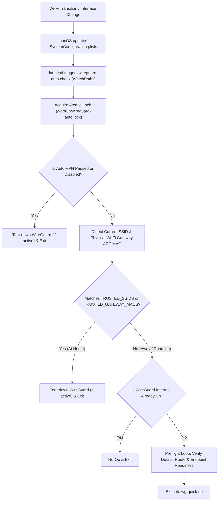

# WireGuard Auto-VPN for macOS 🛡️

[-000000?style=flat-square&logo=apple&logoColor=white)](https://github.com/rajivghandi767/wireguard-autovpn-macos)
[%20%26%20Apple%20Silicon%20(arm64)-0071C5?style=flat-square)](https://github.com/rajivghandi767/wireguard-autovpn-macos)
[](https://github.com/rajivghandi767/wireguard-autovpn-macos)
[](https://github.com/rajivghandi767/wireguard-autovpn-macos/actions)
[](LICENSE)

Lightweight, zero-polling, event-driven WireGuard automation for macOS (`x86_64` Intel & `arm64` Apple Silicon) powered by `launchd` and `wireguard-tools`.

Automatically brings up a split-tunnel WireGuard connection to your home network when roaming on untrusted Wi-Fi or cellular hotspots and tears it down when returning home—with **zero background CPU polling** and native coexistence alongside full-tunnel commercial VPNs (such as **NordVPN**).

---

## 🎯 Project Intent & The "Best of Both Worlds" Problem

While running a self-hosted bare-metal [Homelab](https://github.com/rajivghandi767/homelab-iac) behind a **UniFi Router**, I needed direct, low-latency remote access from my MacBook to internal infrastructure services (Prometheus, Grafana, HashiCorp Vault, Pi-hole, pgAdmin, and the UniFi Controller) while away from home **without publishing internal administrative domains to the public internet**.

At the same time, when working from coffee shops, airports, or hotels, I wanted to keep **NordVPN** active for general web browsing, encrypted public Wi-Fi traffic, and geo-location switching. Existing options fell short:

1. **No SSID On-Demand in the Official macOS App:** Unlike the iOS WireGuard app, the official macOS WireGuard GUI client does not support automatic SSID-based On-Demand toggling unless provisioned via enterprise Apple MDM configuration profiles (`mobileconfig`).
2. **Dual-VPN Routing Collisions:** Running a full-tunnel commercial VPN alongside a full-tunnel WireGuard client causes default-gateway race conditions. By combining `wireguard-go` split-tunneling (`AllowedIPs` scoped strictly to internal homelab subnets) with an automated route/DNS readiness preflight loop, **both VPNs run simultaneously**—NordVPN encrypts all public internet traffic (`0.0.0.0/0`) while `wireguard-auto` transparently routes private subnet traffic (`10.100.x.x` / `192.168.x.x`) directly to the UniFi router.
3. **Cross-Architecture Portability (`x86_64` $\rightarrow$ `arm64`):** Built on an Early 2015 Intel MacBook Pro (macOS Monterey) with forward-compatible support for Apple Silicon M-series Macs (macOS Sonoma, Sequoia, and Tahoe), dynamically resolving Homebrew prefixes (`/usr/local` vs. `/opt/homebrew`) and modern macOS Wi-Fi privacy redaction out of the box.

| Capability | Official WireGuard macOS App | Naive Polling Scripts (`while true; sleep 5`) | `wireguard-autovpn-macos` |
| :--- | :---: | :---: | :---: |
| **Automatic Trusted Wi-Fi Disconnection** | ❌ (Requires Apple MDM Profile) | ✅ | ✅ |
| **Zero Background Polling (Battery Safe)** | ✅ | ❌ (Constant CPU wakeups) | ✅ (`launchd` `WatchPaths`) |
| **Coexists with Commercial VPNs (NordVPN)** | ⚠️ (Manual split-tunnel timing) | ❌ (Boot/wake race conditions) | ✅ (Route & DNS preflight loop) |
| **macOS Sonoma / Sequoia `<redacted>` SSID Support** | ❌ | ❌ | ✅ (Normalized Gateway ARP MAC fallback) |
| **Captive Portal CLI Override (`pause` / `resume`)** | ❌ | ❌ | ✅ |

---

## 🏛️ Event-Driven Architecture

Instead of running a persistent background loop that drains laptop battery by polling `networksetup` every few seconds, `wireguard-autovpn-macos` registers a native macOS `LaunchDaemon` (`com.wireguard.autovpn`) that watches `/Library/Preferences/SystemConfiguration/` for kernel-level network state changes:



### Key Architectural Highlights

- **Zero-Polling `launchd` Triggers:** Reacts exclusively when `/Library/Preferences/SystemConfiguration/com.apple.airport.preferences.plist` or `preferences.plist` mutates (with a 5-second `ThrottleInterval` debounce and a 5-minute `StartInterval` sanity check).
- **Apple Silicon (`arm64`) & Modern macOS Privacy Compatibility:**
  - Starting in macOS Sonoma 14.4+, Sequoia 15, and Tahoe 16, Apple redacts Wi-Fi SSIDs (`<redacted>`) from background daemons lacking foreground CoreLocation entitlements.
  - When `<redacted>` is detected, `wireguard-auto` queries the physical Wi-Fi interface's DHCP router (`ipconfig getoption en0 router`—bypassing any virtual default gateway injected by NordVPN), warms the kernel ARP cache if needed, normalizes BSD `arp`'s zero-stripped hex octets (`0:1a:2b:...` $\rightarrow$ `00:1a:2b:...`), and matches against `TRUSTED_GATEWAY_MACS`.
- **Fast Endpoint Preflight (No `mDNSResponder` Hangs):** Before bringing up the tunnel away from home, `wait_for_network_readiness` verifies that a valid default route exists. If the WireGuard `Endpoint` is a domain name, it verifies DNS resolution via `dscacheutil`; if the `Endpoint` is a raw IPv4/IPv6 literal (standard for UniFi WireGuard configs), it bypasses DNS lookup to avoid macOS `mDNSResponder` reverse-lookup timeouts.

---

## 🔐 Security Architecture

Because `wg-quick` requires `root` privileges to create `utun` kernel interfaces and modify macOS routing tables, `wireguard-auto` is hardened against local privilege escalation (LPE) and untrusted wireless inputs:

1. **Zero `source` / `eval` Config Parsing:** Unlike traditional shell daemons that run `source autovpn.conf` as `root`, `wireguard-auto` uses a strict, line-by-line declarative parser (`parse_config`). Arbitrary shell commands, backticks, or `$(...)` command substitutions inside `autovpn.conf` are never executed.
2. **Root-Isolated Daemon Binary Path:** Because Homebrew prefixes (`/opt/homebrew/bin` on Apple Silicon and `/usr/local/bin` on Intel) are writable by standard local user accounts, `install.sh` places the actual daemon executable inside `/Library/Application Support/wireguard-auto/bin/wireguard-auto` (`root:wheel`, `0755`) and points `launchd` solely to that root-protected path. A convenience symlink is placed in `${BREW_PREFIX}/bin/wireguard-auto` for terminal CLI usage.
3. **Config Ownership & Symlink Verification:** When invoked as `root`, `verify_config_security` refuses to read `autovpn.conf` if it is a symbolic link, not owned by `root` (`UID 0`), or group/world-writable.
4. **Protected Runtime State in `/var/run`:** Concurrency locks (`/var/run/wireguard-auto.lock`) and temporary pause flags (`/var/run/wireguard-auto.paused`) reside in root/daemon-owned `/var/run` rather than world-writable `/tmp`, preventing symlink attacks and preventing unprivileged processes from silently tearing down the VPN without `sudo`.
5. **Untrusted SSID & Interface Sanitization:** Over-the-air Wi-Fi SSIDs are treated as untrusted external strings (never evaluated or glob-expanded), and `WG_INTERFACE` is strictly validated against `^[a-zA-Z0-9_-]{1,15}$` to prevent path traversal.

---

## 📦 Prerequisites & Split-Tunnel Setup

### 1. Install `wireguard-tools`
Install `wireguard-tools` via Homebrew (which automatically installs `wireguard-go` and `bash` 5+):

```bash
brew install wireguard-tools
```

### 2. Configure Your Split-Tunnel WireGuard Profile
Export your client configuration from your UniFi Router (or WireGuard server) and save it to Homebrew's WireGuard directory:
- **Apple Silicon (M1/M2/M3/M4):** `/opt/homebrew/etc/wireguard/homevpn.conf`
- **Intel (`x86_64`):** `/usr/local/etc/wireguard/homevpn.conf`

> [!TIP]
> **Coexisting with NordVPN / Commercial VPNs:** Set `AllowedIPs` in your `homevpn.conf` to your private homelab and WireGuard subnets rather than `0.0.0.0/0`. This ensures `wg-quick` only adds specific static routes for your local network without fighting NordVPN for the system default route:

```ini
[Interface]
PrivateKey = <REDACTED_CLIENT_PRIVATE_KEY>
Address = 10.100.10.2/32
# Optional: Point DNS to your internal Pi-hole / UniFi DNS resolver
DNS = 10.100.11.4

[Peer]
PublicKey = <REDACTED_SERVER_PUBLIC_KEY>
Endpoint = 203.0.113.50:51820
# Route only WireGuard subnet (10.100.10.0/24) and Homelab VLANs (10.100.11.0/24)
AllowedIPs = 10.100.10.0/24, 10.100.11.0/24
PersistentKeepalive = 25
```

---

## 🚀 Installation & Configuration

### Option 1: Install via Homebrew Tap (Recommended)
Installing via the custom Homebrew Tap automatically pulls in `bash` and `wireguard-tools` and verifies the release tarball's SHA-256 checksum:

```bash
brew install rajivghandi767/tap/wireguard-autovpn-macos
sudo wireguard-auto install-daemon
```

### Option 2: Install from Source
```bash
git clone https://github.com/rajivghandi767/wireguard-autovpn-macos.git
cd wireguard-autovpn-macos
sudo ./install.sh
```

---

### Post-Install Configuration

1. **Inspect your current network & Gateway MAC (while connected to home Wi-Fi):**
   ```bash
   wireguard-auto status
   ```
   Example output:
   ```text
   ==============================================
            WireGuard Auto-VPN Status            
   ==============================================
   Version             : v1.0.0
   Homebrew Prefix     : /opt/homebrew
   Configured Profile  : homevpn
   Trusted SSID(s)     : Your-Home-WiFi-SSID
   Trusted Gateway MACs: <None>
   Current SSID        : <Redacted by macOS Privacy — use TRUSTED_GATEWAY_MACS>
   Current Gateway MAC : 78:45:58:xx:xx:xx
   Default Gateway Int : en0
   WireGuard Interface : DOWN (inactive)
   Auto-Connect Mode   : ENABLED (automatic)
   ==============================================
   ```

2. **Configure your trusted home network in `<BREW_PREFIX>/etc/wireguard/autovpn.conf`:**
   ```bash
   sudo nano "$(brew --prefix)/etc/wireguard/autovpn.conf"
   ```
   ```bash
   WG_INTERFACE="homevpn"

   # Used on macOS Monterey / Ventura (or when SSID is visible)
   TRUSTED_SSIDS=(
       "My-Home-WiFi"
   )

   # Recommended for all M-Series Macs / macOS Sonoma 14.4+, Sequoia 15, and Tahoe 16:
   # Paste the "Current Gateway MAC" shown by 'wireguard-auto status' when at home:
   TRUSTED_GATEWAY_MACS=(
       "78:45:58:xx:xx:xx"
   )
   ```

3. **Trigger an immediate evaluation:**
   ```bash
   sudo wireguard-auto check
   ```

---

## 💻 CLI Usage

```text
wireguard-auto v1.0.0
Usage: wireguard-auto [command]

Commands:
  check             Evaluate network and activate/deactivate WireGuard (called by launchd)
  status            Show current Wi-Fi network, gateway MAC, WireGuard state, and mode
  pause             Temporarily disable auto-connect and bring down WireGuard (captive portals)
  resume            Re-enable auto-connect and evaluate current network
  disable           Persistently disable auto-connect across reboots
  enable            Same as resume
  install-daemon    Install/update and load the root LaunchDaemon (requires sudo)
  uninstall-daemon  Unload and remove the root LaunchDaemon (requires sudo)
  version           Display version information
  help              Display this help message
```

### Captive Portal Workflow (Hotels / Flights / Cafes)
When joining a public Wi-Fi network that requires a browser login splash page before granting internet access:
```bash
# 1. Pause auto-VPN and tear down the WireGuard interface
wireguard-auto pause

# 2. Complete the hotel/airport Wi-Fi captive portal login in your browser

# 3. Re-enable auto-connect and bring the tunnel back up
wireguard-auto resume
```

---

## 🔍 Verification, Logs & Testing

### Live Daemon Logs
All state transitions are logged with timestamps to `/var/log/wireguard-auto.log` (automatically rotated at 5 MB):
```bash
sudo tail -f /var/log/wireguard-auto.log
```

### Running the Security & Unit Test Suite
The repository includes a zero-dependency sandboxed test suite (`tests/test_wireguard_auto.sh`) that validates syntax, plist lints, command-injection prevention, path-traversal rejection, BSD `arp` MAC normalization, and state transitions:
```bash
./tests/test_wireguard_auto.sh
```

### Upgrading
To update to the latest release while preserving your existing `autovpn.conf` and WireGuard profiles:
```bash
# If installed via Homebrew Tap:
brew update && brew upgrade wireguard-autovpn-macos
sudo wireguard-auto install-daemon

# If installed from source:
git pull origin main && sudo ./install.sh
```

### Uninstallation
To cleanly unload the `launchd` daemon and remove the binary and CLI symlink while preserving your WireGuard `.conf` files:
```bash
sudo wireguard-auto uninstall-daemon
# Optional (if installed via Homebrew):
brew uninstall wireguard-autovpn-macos
```

---

## 📂 Directory Structure

```text
📦 wireguard-autovpn-macos/
├── ⚙️ .github/workflows/
│   └── ci.yml                        # ShellCheck & macOS unit test pipeline
├── 🔧 bin/
│   └── wireguard-auto                # Core daemon & CLI utility (Bash 5+)
├── 📋 config/
│   ├── autovpn.conf.example          # Declarative configuration template
│   └── com.wireguard.autovpn.plist   # Event-driven launchd daemon definition
├── 🧪 tests/
│   └── test_wireguard_auto.sh        # Automated security & unit test suite
├── 🚀 install.sh                     # Idempotent root-hardened installer
├── 🧹 uninstall.sh                   # Clean daemon & symlink uninstaller
├── 📄 LICENSE                        # MIT License
└── 📖 README.md                      # Architectural & operational documentation
```

---

## 📬 Let's Connect

**Rajiv Wallace**  
*Self-taught Software Engineer based in NYC (originally from Dominica 🇩🇲). Aviation nerd, Formula One fan, Chelsea FC supporter, and passionate about robust Backend Development and bare-metal DevOps.*

[](https://www.linkedin.com/in/rajiv-wallace)
[](mailto:dev@rajivwallace.com)
[](https://rajivwallace.com)
